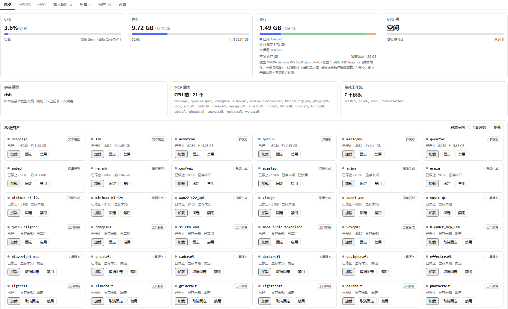
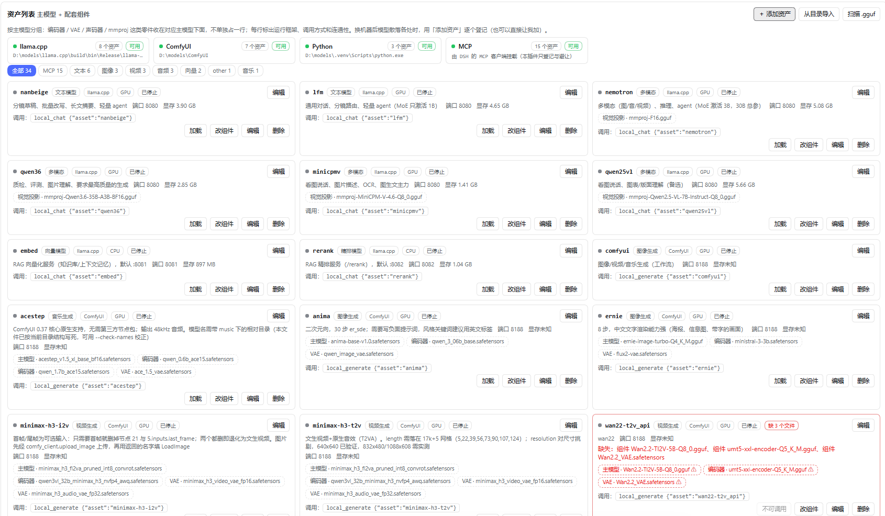
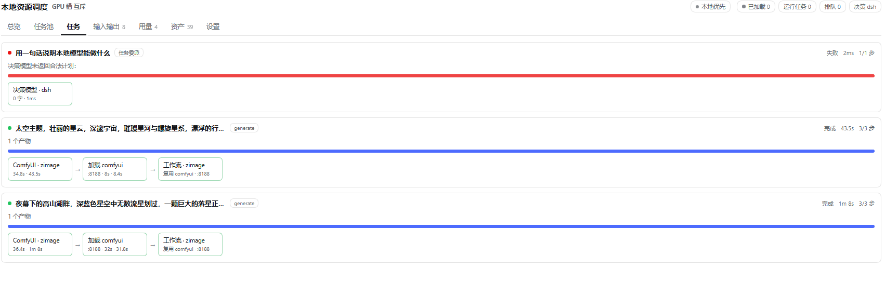
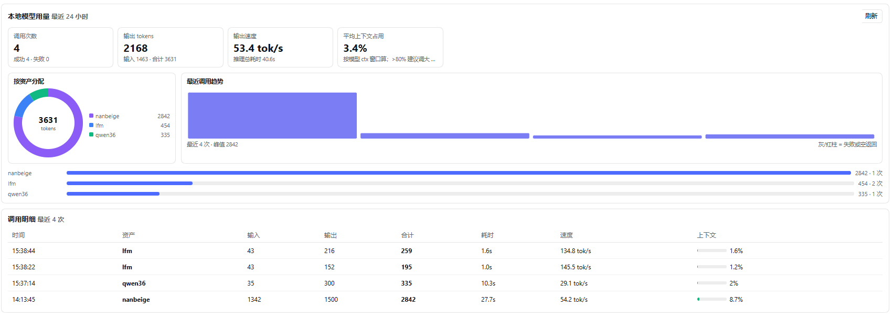

# dsh-local-orchestrator

**A local resource-scheduling runtime for agents on consumer hardware with limited VRAM.**

It puts LLMs, generative workflows (ComfyUI), one-shot scripts and MCP servers into **one budget table**,
and separates *deciding* from *executing* with **single-step tools + a task state machine** — so an agent
can load, swap, queue and resume local work on an 8 GB card without hand-killing processes.

> Not another agent framework: no LLM loop, no tool protocol, no session/memory layer.
> It answers four questions only: how much VRAM is left, who runs next, how to account for it,
> and who cleans up when something gets stuck.

It is a plugin for [DeepSeek Harness](https://github.com/deepseek-ai) (DSH) and has been developed
and measured on `RTX 5060 Laptop 8GB / 32GB RAM`, Windows.

📖 Full design and measured numbers (Chinese): [docs/OVERVIEW.md](docs/OVERVIEW.md)

## Screenshots

<p align="center">
  
  
</p>
<p align="center">
  
  
</p>

## What it solves

| Pain | Without a scheduler | With this plugin |
|---|---|---|
| Swap a model, get OOM | kill processes by hand, wait for the driver | GPU mutex + budget table: evict, wait for VRAM to fall, load |
| VRAM math is guesswork | eyeball the parameter count | `min(free, total × (1 - reserve)) - fixed`, backfilled from real loads |
| Long tasks die with the session | rerun from scratch | task state machine persisted to disk; `running → paused` on restart, resumable |
| One session hogs the GPU | others wait | lease table rounds across sessions; max 1 consecutive step |
| No idea where tokens/money go | "it feels slow" | token ledger: which asset, how many tokens, tok/s, context usage |
| Model file deleted, still called | crash mid-run | connectivity checks: missing files are flagged and skipped by routing |

## Three core pieces

| Piece | What it does |
|---|---|
| **Budget table** | one account for LLM / workflows / scripts / MCP: who occupies how much VRAM |
| **Single-step tool** | one call advances one step; `local_step` and the background worker share one `StepRunner` |
| **Task state machine** | `queued → running → waiting_decision → done`; cross-session, persisted, resumable |

> Decision authority stays in the host, execution authority lives in the plugin, and the task state is
> the only contract between them.

## Ten tools

`local_resources` · `local_assets` · `local_chat` · `local_service` · `local_delegate` ·
`local_generate` · `local_audio` · `local_task` · `local_step` · `local_env`

`local_env` keeps the runtime portable: `doctor` reports every environment problem as one actionable
fix, `vendor-llama` copies llama.cpp into the plugin, `link-comfy` records where ComfyUI lives, and
`set-model-root` points at your model directory. Model files are never moved.

Assets are *resources* addressed by an `asset` parameter and picked by the scheduler (VRAM fit, strengths,
already loaded). Not one-tool-per-model: tool schemas go into context every turn.

## Reproducible numbers

```bash
node scripts/bench.mjs
```

| Metric | Value |
|---|---|
| Task recovery after crash/restart | **100% (20/20)** |
| Max consecutive GPU steps across sessions | **1** |
| Per-step overhead | **2.5–2.6 ms** |

Measured on the reference machine: 3B model cold start 39.8–45.4 s, 512×512 image 44.8 s,
4.8 s TTS audio 19.9 s (RTF 4.15).

## Usage (five minutes)

### 1. Install

```bash
git clone https://github.com/metagalaxy-crystal/dsh-local-orchestrator.git
cd dsh-local-orchestrator
dsh plugin add .        # or add the directory to your plugin folder
```

Restart DSH; a **Local Scheduling** tab appears.

### 2. Configure the environment once

Everything under one root directory? One command derives every path:

```bash
npm run setup -- --base D:\models
```

The agent can do the same:

```jsonc
{"action":"set-base","dir":"D:\\models"}
{"action":"doctor"}                  // ok / ! / x per item, each with one fix
{"action":"vendor-llama"}            // copy llama.cpp into the plugin (~77 MB)
{"action":"link-comfy","dir":"D:\\models\\ComfyUI"}
```

All `[ok]` means you are good to go; any `[x]` tells you exactly what to do next.

### 3. Register assets

- **Import a directory**: Assets tab → "Import from directory";
- **Add one**: Assets tab → "＋ Add asset";
- **Ask the agent**: `local_assets {"action":"add","asset":{"id":"my-qwen","gguf":"text/my-qwen/model.gguf","ctx":8192}}`.

### 4. Everyday calls

```jsonc
// chat (auto load / unload)
local_chat {"prompt":"hello"}
local_chat {"asset":"qwen36","prompt":"describe this","imagePath":"D:\\x.png"}

// image / video / music
local_generate {"prompt":"an orange cat on a windowsill","kind":"image"}
local_generate {"asset":"minimax-h3-t2v","prompt":"night city aerial","kind":"video"}

// multi-step task: pause/resume/recover
local_task {"action":"create","goal":"write three slogans","steps":[{"goal":"write three slogans","kind":"llm"}]}
local_step {"action":"run","taskId":"task-xxx"}

// speech
local_audio {"action":"tts","text":"hello from the local machine"}
local_audio {"action":"asr","audioPath":"D:\\x.wav"}
```

### 5. Inspect

Web tab: Overview (three-segment VRAM bar) / Task pool / Usage / Assets.
Tools: `local_resources {"verbose":true}` shows compute, assets, 24 h usage and recent events.

### 6. When something breaks

```jsonc
local_env {"action":"doctor"}
```

Every item is one line plus one action. Model path wrong, llama.cpp missing, ComfyUI not found —
this is where you find out.

## Limitations (honest list)

- **Windows VRAM attribution**: WDDM hides per-process VRAM (`nvidia-smi` shows `[N/A]`); only totals and
  before/after deltas are reliable.
- First estimate per asset is a guess until a real load backfills it.
- **Small local models plan badly**: a 3B model rarely emits valid JSON plans. JSON mode + one retry +
  degraded single-step fallback are in place, but prefer DeepSeek or an 8B-MoE local model for planning.
- Process/script handling is polished on Windows; Linux works but is not individually tested.
- Single GPU only (no multi-GPU or cluster scheduling).

## Development

```bash
node test/stats.test.js     # run one file (sandboxes may block `node --test`)
node scripts/bench.mjs      # three benchmarks
npm run verify              # tool verification ledger (only changed tools need re-verification)
```

Assets are described in `catalog.json`; each asset is one loadable local service with optional components
(encoder / VAE / vocoder / mmproj) that are hidden from scheduling.

## License

MIT
