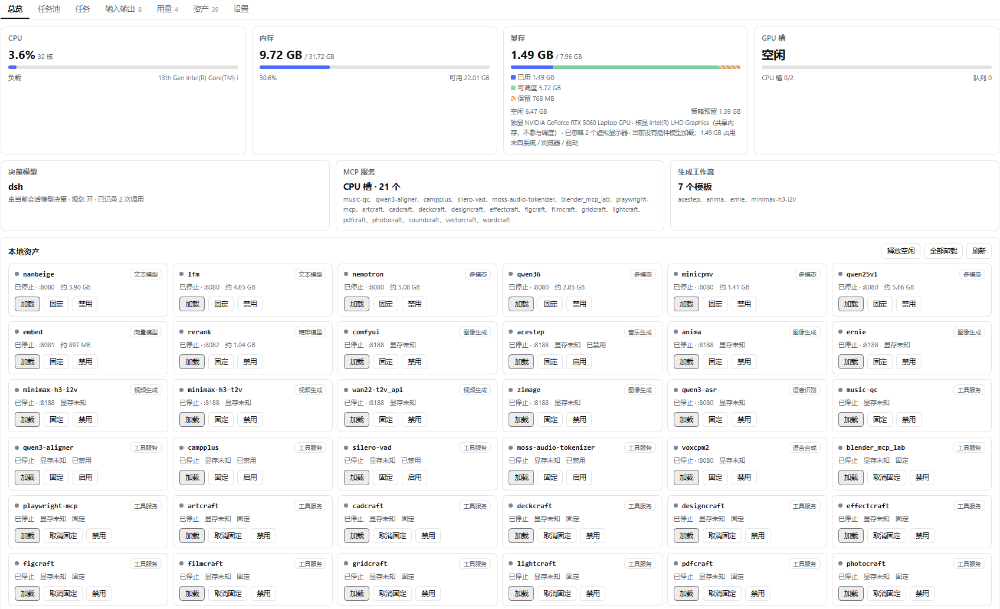
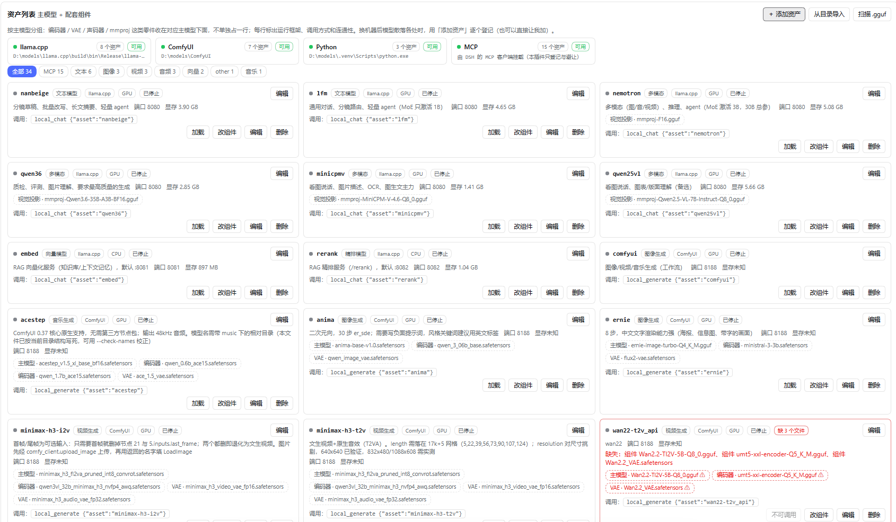
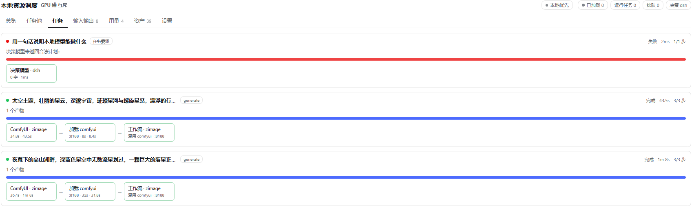
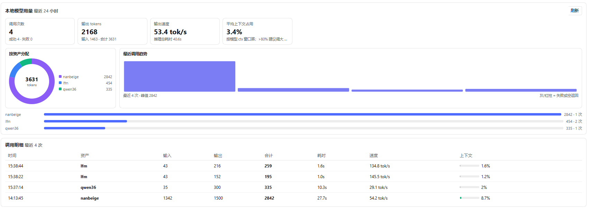

# dsh-local-orchestrator

[](https://github.com/metagalaxy-crystal/dsh-local-orchestrator/actions/workflows/test.yml)
[](LICENSE)
[](package.json)
[](https://github.com/metagalaxy-crystal/dsh-local-orchestrator/releases)

**简体中文** · [English](README.en.md)

**单卡消费级设备上、给 agent 用的资源调度运行时**：把 LLM、生成式工作流、一次性脚本统一进一张预算表，
用「单步工具 + 任务状态机」把决策权和执行权分开，支持跨会话任务的暂停与唤醒。

> 它**不是**一个新的 agent 框架：不实现 LLM 循环、不做工具调用协议、不管会话与记忆。
> 它只回答四个问题：现在卡上还剩多少、这一步该谁先跑、跑完怎么记账、卡住了谁来收尸。

> 适用场景：一台带 NVIDIA 显卡的机器（本项目实测 RTX 5060 Laptop 8GB / 32GB RAM），
> 已经用 llama.cpp 跑 GGUF、用 ComfyUI 出图/视频，希望 agent 能按任务自动加载/卸载，
> 把简单、批量、隐私、离线的活交给本地算力。

📄 **第一次来先看这里：[docs/OVERVIEW.md](docs/OVERVIEW.md)** —— 它解决哪些具体痛点、十个工具能做什么、
实测数字、适用/不适用、局限、快速开始。本 README 是完整参考手册。

```bash
# 三个指标，不用装模型就能复现
node scripts/bench.mjs
# 工具真实调用台账（改了哪个工具就只重验哪个）
npm run verify
```

## 三个核心物件

| 物件 | 解决什么 | 在哪 |
|---|---|---|
| **预算表** | LLM / 工作流 / 脚本 / MCP 共用一本账：谁占了多少显存、按科目合计多少、新东西放不放得下 | [lib/budget.js](lib/budget.js) |
| **单步工具** | 一次工具调用只推进一步；`local_step` 与后台 worker 共用同一个 `StepRunner`，规则只有一份 | [lib/steps.js](lib/steps.js)、[lib/tools.js](lib/tools.js) |
| **任务状态机** | `queued → running → waiting_decision → done`；跨会话、落盘、可恢复、暂停即真正打断 | [lib/tasks.js](lib/tasks.js) |

一句话：**决策权在宿主，执行权在插件，状态是两者唯一的契约。**

## 三个可复现数字

不需要加载模型，`node scripts/bench.mjs` 直接跑（结果与硬件无关）：

| 指标 | 当前值 | 含义 |
|---|---|---|
| 任务恢复率 | **100%**（20/20，崩溃中 5 个） | 进程重启后，执行中的任务降级为 paused、步骤回退，能接着跑 |
| 跨会话公平性 | **最大连续独占 1 步**（2 会话 30 步，15/15 均分） | 两会话交替推进，谁也不被饿死 |
| 单步开销 | **2.6 ms/步**（含任务落盘） | 运行时包一层的成本，相对 45s 冷启动可忽略 |

`--json` 会把结果写进 `bench/bench-<ts>.json`。显存估算误差（<6%）需要真机，后续以 `--gpu` 模式接入。

## 与 DSH 现有能力的分工

| 能力 | 由谁负责 |
|---|---|
| 记忆（长期/项目/每日）、会话、统计、Web 浏览上下文 | DSH 已有插件（如 `dsh-memory-evolve`、`dsh-context`） |
| 模型决策（任务分解、调用哪个本地模型） | 当前 DSH 会话模型，或本插件配置的**决策模型** |
| 本地算力探测、模型/运行时注册、加载卸载、显存预算 | **本插件** |

本插件不重复实现记忆、RAG、浏览器、UI 会话——只解决「本地资源怎么被用起来」。

## 架构

```
DSH 会话模型（DeepSeek / 自定义）
        │  工具调用
        ▼
┌───────────────────────────────────────────────┐
│ lib/tools.js  10 个工具（resources/assets/     │
│                chat/service/delegate/generate/ │
│                audio/task/step/env）           │
├───────────────────────────────────────────────┤
│ lib/tasks.js   任务池：Task/Step 状态机、       │
│                按会话隔离、持久化、断点恢复    │
├───────────────────────────────────────────────┤
│ lib/steps.js   单步执行器：前后台共用           │
│                claim → 租约 → 执行 → 判定      │
│ lib/worker.js  后台执行环：关页面也继续跑，    │
│                到决策点停住并唤醒所属会话      │
│ lib/leases.js  租约表：GPU/CPU 槽、按会话轮转  │
│ lib/budget.js  预算表：LLM/工作流/脚本 统一记账 │
├───────────────────────────────────────────────┤
│ lib/tracker.js   任务框图 / 节点进度 / IO 轨迹  │
│ lib/api.js + web.js   /api/local-orchestrator  │
│ lib/client.js     「本地调度」页签（React UI） │
├───────────────────────────────────────────────┤
│ lib/decision.js  决策模型（session/dsh/       │
│                  openai/local）→ 任务计划      │
├───────────────────────────────────────────────┤
│ lib/manager.js   编排器：GPU 槽互斥、显存预算、 │
│                  LRU 淘汰、空闲回收、排队      │
├───────────────────────────────────────────────┤
│ runtimes/  llama.cpp · ComfyUI · 通用进程      │
├───────────────────────────────────────────────┤
│ hardware.js   CPU / 内存 / nvidia-smi 显存     │
│ catalog.js    资产目录（模型/服务/成本画像）   │
└───────────────────────────────────────────────┘
```

任务池的三条边界（详见 [docs/PLAN-v2-有限资源调度器改造方案.md](docs/PLAN-v2-有限资源调度器改造方案.md)）：

- **决策环在宿主**：谁决定「下一步做什么」是会话模型；插件不自造 agent 循环。
- **执行环在插件**：`local_step` 一次只推进一步；需要判断的步骤停下来等模型，不硬跑。
- **后台跑但要叫人**：`running` 的任务由 worker 继续推进；到 `require` 判断点、失败、超预算时
  用 `schedule` 唤醒**任务所属会话**，不广播、不打扰别的会话。

> 三张图：[双环调度总览](docs/flow-v2.png)（一张图看全流程） · [架构总览](docs/architecture-v2.png) · [双循环与三种协作形态](docs/loops-v2.png)。

### 界面

Web 端有一个「本地调度」页签，七个子页：总览 / 任务池 / 任务 / 输入输出 / 用量 / 资产 / 设置。

<p align="center">
  
  
</p>
<p align="center">
  
  
</p>

左上：**总览**——显存卡分三段（已用 / 可调度 / 保留），下面每张资产卡直接给加载/固定/禁用。
右上：**资产**——顶部运行框架条，主模型卡片里挂配套组件（视觉投影 / 编码器 / VAE），缺文件的标红。
左下：**任务**——每个 run 一张框图，节点带耗时；失败任务标红并写明原因。
右下：**用量**——24h 调用次数、tokens、tok/s、上下文占用，以及按资产的 token 分布。

**调度策略**（默认针对 8GB 显存调优）：

1. **GPU 槽互斥**：同一时刻只有一个吃显存的资产（LLM / ComfyUI / 语音）；切换时先停后起。
2. **显存预算**：可用显存 = `min(当前空闲, 总量×(1-预留比例)) - 固定预留`；放不下就先按
   「未固定 → 优先级低 → 最久未用」淘汰。
   - 预算**只算独显**：核显用系统内存（DVMT/共享内存），nvidia-smi 看不到，也不进调度；
     ToDesk / GameViewer 这类虚拟显示器会被识别为 `virtual` 并忽略。
   - 检测到核显时，桌面基础占用通常更低，可把 `hardware.reserveVramMb` 从 768 调到 384~512。
   - 总览页的显存卡分三段：**已用 / 可调度 / 保留**（保留段是斜纹），不会把预留读成占用。
3. **CPU 槽并发**：embed / rerank / MCP 这类零显存资产并行加载，不抢 GPU 槽。
4. **实测学习**：每次加载后量出真实显存占用（优先从 llama-server 日志的
   `model/KV/compute buffer size` 相加；Windows WDDM 下按进程数据是 `[N/A]`，
   再退化为「加载前后总占用之差」），指数平滑写回资产画像。
5. **自动调参**：读 GGUF 元数据（层数 / KV 头数 / head_dim）算 KV，按当前可用显存
   自动选 `ctx`、`ngl`、KV 量化（f16 → q8_0 → q4_0），并显式加 `--parallel 1`
   （llama-server 默认 4 个槽，每个槽都占计算缓冲）。配置项 `scheduler.autoTune`。
6. **端口回退**：Windows 动态端口范围从 1024 起，`8080` 可能被别的程序当临时端口占住
   （bind 报 EACCES，netstat 却看不到 LISTENING）。插件会退避重试并自动换一个空闲端口，
   客户端始终按实例实际端口通信（`config.scheduler.autoPort`，默认开）。
7. **空闲回收**：超过 `idleUnloadSec` 未使用自动卸载（`pinned: true` 的资产除外）。
8. **任务结束释放**：所有任务结束后等 `releaseAfterTaskSec` 秒（默认 **30**），自动卸载
   空闲且未 `pinned` 的本地模型与运行时；期间来了新任务会取消倒计时。手动「预加载」
   （`local_service load`）不触发这条规则，交给 `idleUnloadSec` 长周期回收。
9. **计划优先**：配了决策模型且开启 planning 时，`local_delegate` 会先拆步骤再执行，
   能复用已加载模型、按能力挑模型。

> 实测参考（RTX 5060 8GB，`nanbeige` 3B Q4_K_M）：
> - `-c 32768` + f16 KV + 默认 4 槽 → 进程占用 **7665MB**（8GB 卡几乎占满）
> - 自动调参后 `-c 32768` + q8_0 KV + `--parallel 1` → **5477MB**（省约 2.2GB）
> - `-c 8192` + f16 → 3791MB
>
> 估算器按这三组真机数据标定，误差 < 6%（见 `test/gguf.test.js`）。

## 图形界面：「本地调度」页签

插件在会话页签栏（对话 / 轨迹 / 记忆 / 上下文 / 技能 / 编队 / 待办 …）注册一个 **「本地调度」** 页签，
页面每 1.5 秒拉一次 `/api/local-orchestrator/state`，实现实时监控：

| 子页 | 内容 |
|---|---|
| **总览** | CPU 负载 / 内存 / 显存 / GPU 槽四张实时仪表卡；**显存卡用分段条区分「已用（系统+模型）/ 可调度 / 保留」**，保留段是斜纹，避免把预留误读成显卡正在被占用；资产卡片网格（状态灯、显存、端口、一键加载/卸载/固定/禁用）；底部是「预算表」科目汇总 |
| **任务池** | 跨会话任务列表：按会话分组，每个任务显示状态、进度、计划摘要；展开看**步骤树**（状态/耗时/重试次数/产出）；执行环卡片显示后台运行状态、当前步骤与租约持有者；支持暂停/恢复/回滚/取消 |
| **任务** | 每个 run 一张卡，用**框图**按顺序画执行节点（决策 → 加载 → 本地推理 → …），节点带状态色、耗时与详情；顶部有进度条（完成步数 / 总步数）与任务总耗时，运行中的节点呼吸闪烁 |
| **输入输出** | 三栏分开：**决策模型**（规划请求/返回）、**本地模型 / 运行**（提示词与输出、token 与耗时）、**MCP / 生成服务**（ComfyUI 工作流与产物 URL）。每条可展开全文 |
| **用量** | 本地模型的 token 消耗：24h 调用次数 / 输入输出 tokens / 输出速度 tok/s / 平均上下文占用；按资产的环形占比图 + 最近 30 次趋势柱 + 明细表（输入、输出、合计、耗时、速度、上下文条形）。数据落 `<数据目录>/usage.jsonl`，重启不丢 |
| **资产** | 顶部是**运行框架**条（llama.cpp / ComfyUI / Python / MCP，各带路径与「可用/缺失」）；下面是按**主模型**分组的双列卡片：标出框架、调用方式（如 `local_generate {"asset":"zimage"}`）、端口与显存；编码器 / VAE / mmproj / 声码器作为**配套组件**收在卡内，不单独占一行；**连通性**不通的卡会标红并写明缺哪个文件；「编辑」在对应卡片下方就地展开 JSON 编辑器 |
| **设置** | 调度策略（GPU 互斥、空闲卸载、CPU 并发、显存预留）、决策模型（session/dsh/openai/local + provider/model/baseUrl/apiKey/localAsset/多步规划）；保存写入 `config.json`，可一键「测试决策模型」 |

任务数据来自 `lib/tracker.js`：`local_chat` 记一次「本地对话」，`local_delegate` 记「任务委派」（含决策节点与每一步），
`local_service load` 记「服务操作」。IO 按 `decision / local / mcp` 三个通道分开存放，前端对应三栏展示。

## 安装

```powershell
dsh plugin --profile desktop add D:\dsh-plugin
```

安装后重启 DeepSeek Harness（插件在启动时装配）。确认：

```powershell
dsh plugin --profile desktop why dsh-local-orchestrator
```

卸载：

```powershell
dsh plugin --profile desktop remove dsh-local-orchestrator
```

> 首次启动会在 `~/.dsh/local-orchestrator/` 下生成 `config.json`、`catalog.json`、
> `events.jsonl`、`logs/`、`tasks/`（任务池，一任务一个 json）。如果检测到
> `D:\models\scripts\llama_cpp\models.json`，会自动导入里面的模型（保留你调好的 `server_args`）。

## 配置

`~/.dsh/local-orchestrator/config.json`（也可在 profile 的插件行里写 `config` 覆盖）。
完整默认值见 `lib/config.js`，常用项：

```jsonc
{
  "enabled": true,
  "paths": {
    "modelsRoot": "D:/models/models",          // GGUF 根目录
    "llamaServer": "D:/models/llama.cpp/build/bin/Release/llama-server.exe",
    "registry": "D:/models/scripts/llama_cpp/models.json",
    "comfyDir": "D:/models/ComfyUI"
  },
  "hardware": {
    "reserveVramMb": 768,        // 给桌面/浏览器留的显存
    "reserveRatio": 0.08,
    "reserveRamMb": 2048
  },
  "scheduler": {
    "gpuExclusive": true,        // 8GB 卡必须 true；显存足够可关
    "maxCpuLoads": 2,
    "autoPort": true,            // 首选端口被系统占用时自动换端口
    "idleUnloadSec": 900,        // 0 = 不自动卸载
    "releaseAfterTaskSec": 30,   // 任务全部结束后多少秒释放空闲资源；0 = 关闭
    "loadTimeoutMs": 600000
  },
  "decision": {
    "mode": "session",           // session | dsh | openai | local
    "provider": "deepseek",
    "model": "",
    "baseUrl": "",
    "apiKey": "",
    "localAsset": "",
    "planning": true,
    "maxSteps": 6
  },
  "tasks": {
    "background": true,          // 任务 running 后由后台执行环继续推进
    "maxSteps": 8,               // 单任务步数上限
    "maxWallMin": 30,            // 单任务总时长上限（分钟）
    "keepFinished": 100          // 终态任务保留条数
  },
  "worker": {
    "enabled": true,
    "tickMs": 2000,              // 检查间隔
    "maxStepMin": 30,            // 单步硬超时（分钟）
    "wakeDelaySec": 5            // 到决策点后多久唤醒会话
  },
  "prompt": { "enabled": true },  // 往系统提示注入本地资源简报
  "web": { "enabled": true }
}
```

### 决策模型：两种来源

UI 只提供两种（`config.decision.mode` 仍保留底层四值以兼容老配置）：

| 选择 | 底层 mode | 含义 | 额外成本 |
|---|---|---|---|
| **DeepSeek（当前会话的 API）** | `dsh` | 直接复用会话的 provider / model / apiKey（`ctx.get('agentDefaultModel').currentSelection()`），不另配密钥；`provider`/`model` 留空即跟随，填了才覆盖 | 计入会话 token |
| **本地文本模型** | `local` + `decision.localAsset` | 规划/评估用本机已注册的文本模型 | 占一块显存，离线可用 |
| （默认/兼容） | `session` | 当前 DSH 会话模型自己决定，插件只执行 | 0 |

选「本地文本模型」时，**DeepSeek（会话模型）仍然负责对话、工具选择和最终答复**，本地模型只承担「把任务拆成步骤」和「评估产出」这两件小事——真正的执行权在插件，不在决策模型。

> 本地小模型直接产 JSON 计划不稳：现在会给 llama-server 带 JSON 约束（`response_format`），失败自动重试一次；仍不合法时**退化为单步执行**（结果里标 `degraded`），不会把任务卡在规划阶段。

## 工具（给会话模型用）

| 工具 | 作用 |
|---|---|
| `local_resources` | 算力与已加载服务总览；`verbose` 附带资产清单与最近事件 |
| `local_assets` | 资产列表（id/类型/槽位/预计显存/状态/擅长） |
| `local_chat` | 在本机模型上跑一次推理（自动加载；支持 `imagePath` 走多模态） |
| `local_service` | `load/stop/restart/stop_all/reap/release/discover/import/sync/set/inspect` |
| `local_delegate` | 一整件任务交给本地：`direct` 单模型 / `plan` 先规划再逐步执行 |
| `local_generate` | ComfyUI 出图/视频/音乐：可指定工作流资产（`zimage`/`ernie`/`minimax-h3-t2v`…）或模板名 |
| `local_audio` | 一次性音频脚本：`tts` 语音合成 / `asr` 转写+分离+SRT / `music-qc` 音乐质检 |
| `local_task` | 任务池：`create/list/get/pause/resume/cancel/rollback/replan`；任务按会话隔离、落盘可恢复 |
| `local_step` | 推进任务一步：`run/retry/skip/inspect`；**一次调用只做一步**，失败自动重试一次 |
| `local_env` | 便携运行时：`doctor` 环境体检（每项带一条 fix）、`plan` 还差什么、`vendor-llama` 把 llama.cpp 复制进插件、`link-comfy` 登记 ComfyUI 路径、`set-model-root` 改模型目录 |

### 便携运行时（下载即用）

环境问题不该让人（和模型）去读日志猜。插件把能收的都收进自己的 `runtime/`：

- `runtime/llama/`：llama-server + 依赖 DLL（约 77MB，MIT），**复制**进来后不再依赖系统安装；
- `runtime/comfy.json`：ComfyUI 目录的**指针**（源码 200MB 不复制，只记路径）；
- `runtime/py/`：可选 venv；torch 约 2.5GB，按需装（打包等于赌用户的 CUDA 版本）；
- 模型**永远不搬**，只登记路径。

```jsonc
{"action":"doctor"}                                    // 逐项 ok / ! / x + fix
{"action":"vendor-llama"}                              // 有现成 llama.cpp 就复制进来
{"action":"link-comfy","dir":"D:\\models\\ComfyUI"}
{"action":"set-model-root","dir":"D:\\models\\models"}
```

细节与取舍：[docs/PORTABLE.md](docs/PORTABLE.md)。

### 任务池怎么用

多步任务优先走 `local_task` + `local_step`，而不是一次 `local_delegate` 跑完——这样中途可暂停、
可回滚、跨回合可续跑：

```
local_task  {"action":"create","goal":"先拟 3 个分镜，再各写一段旁白"}
local_step  {"action":"run","taskId":"task-xxx"}    ← 一次推进 1 步
local_step  {"action":"run","taskId":"task-xxx"}    ← 继续下一步
local_task  {"action":"rollback","taskId":"task-xxx","toIndex":2}   ← 第 2 步起重来
```

- **后台继续跑**：任务进入 `running` 后，`worker` 每 2 秒检查一次，把它一步步跑完；
  关掉页面/切到别的会话都不影响。`{"action":"create","background":false}` 可改成纯手动推进。
- **到点叫人**：步骤 `verification {"mode":"require"}`、连续失败、超预算时任务转 `waiting_decision`，
  插件用 `schedule` 给**任务所属会话**发一条提醒（`worker.wakeDelaySec`，默认 5 秒后），
  会话里用 `local_task get` 看详情、`retry`/`rollback`/`cancel` 决定下一步。
- **质量评估**：计划里加 `kind: "evaluate"` 的步骤（`dependsOn` 指向前一步，`rubric` 写标准），
  会用 VLM 出 `{pass, score, issues}`，不达标则步骤失败，走重试/回滚。
- 任务状态：`queued → running → done/error/cancelled`，可 `paused`；重启后自动降级为 `paused` 等你恢复。
- 隔离：`local_task list` 默认只列当前会话；停一个会话只暂停它自己的任务；GPU 槽按会话轮转，饿不死。
- 熔断：单任务默认最多 8 步 / 30 分钟；同一失败步骤连续 2 次后任务转 `error`，需 `retry` 或 `rollback`。

典型对话：

> 「把这份周报压缩成 10 条要点」→ DSH 调 `local_chat`（自动挑 lfm/nanbeige，加载后执行）。
>
> 「先拟 3 个短视频分镜，再给每个分镜写一段旁白」→ `local_delegate` + 决策模型规划。
>
> 「看看现在显存够不够跑 qwen36」→ `local_resources`。
>
> 「用 txt2img 工作流出 4 张赛博朋克城市图」→ `local_generate`（工作流模板放 `<数据目录>/workflows/`）。

HTTP API（供页签/脚本，Web 模式下可用）：

```
GET    /api/local-orchestrator/state            实时快照（硬件/资产/任务/IO/配置）
GET    /api/local-orchestrator/assets           资产列表
POST   /api/local-orchestrator/assets           新增或更新资产 {"asset":{...}}
DELETE /api/local-orchestrator/assets/{id}      删除资产（运行中会先卸载）
POST   /api/local-orchestrator/action           {"action":"load|stop|restart|stop_all|reap|release|discover|import|clear_runs","asset":"qwen36"}
GET    /api/local-orchestrator/config           配置（apiKey 打码）
PUT    /api/local-orchestrator/config           修改配置 {"patch":{"scheduler":{...},"decision":{...}}}
GET    /api/local-orchestrator/prefs            本地优先开关 {"sessionId"} → {"preferLocal"}
POST   /api/local-orchestrator/prefs            切换开关 {"sessionId","preferLocal":true}
GET    /api/local-orchestrator/tasks            任务列表（?all=1 列出全部会话）
POST   /api/local-orchestrator/tasks            任务操作 {"taskId","action":"pause|resume|cancel|rollback","toIndex":2}
POST   /api/local-orchestrator/decision/test    试跑决策模型 {"prompt":"..."}
```

## 输入框旁「本地优先」开关

会话输入框左侧有一个 **「本地优先」** 胶囊按钮（`conversation.input.left`）：

- 点一下开启 → 该会话的系统提示里追加一段指令，要求模型**优先**用 `local_delegate` / `local_chat` /
  `local_generate`，本地确实做不了才用云端；同时提示任务结束可 `local_service release` 回收显存；
- 再点一下关闭；状态按会话独立保存（`~/.dsh/local-orchestrator/prefs.json`），刷新/重启后保留；
- 拿不到会话 id 时（例如某些宿主版本）退回全局开关，行为一致。

## 资源分类（按 D:\models 自动同步）

插件启动时会读 `D:\models` 的目录结构执行一次 `syncEcosystem`（运行中也可
`local_service {"action":"sync"}` 手动触发）。按当前机器实测，共登记 **27 项**：

| 分类 | 资源 |
|---|---|
| **text** | qwen36（35B MoE 多模态）、nemotron（30B Omni）、minicpmv、qwen25vl、lfm、nanbeige |
| **vector** | embed（Qwen3-Embedding-0.6B）、rerank（Qwen3-Reranker-0.6B）|
| **image** | ComfyUI 服务 + 工作流 `zimage` / `ernie` / `anima` |
| **video** | 工作流 `minimax-h3-t2v` / `minimax-h3-i2v` / `wan22-t2v_api` |
| **music** | 工作流 `acestep`（ACE-Step 文生音乐）|
| **audio** | 可执行脚本：`voxcpm2`（TTS，入口 `scripts/other/tts_run.py`，支持声音克隆 / Voice Design）、`qwen3-asr`（转写+分离+SRT）、`music-qc`（音乐质检）；依赖模型（禁用）：`qwen3-aligner` / `campplus` / `silero-vad` |
| **mcp** | `playwright-mcp`、`blender_mcp_lab`、ArtCraft 13 个 app（`cadcraft` / `deckcraft` / `designcraft` / `effectcraft` / `figcraft` / `filmcraft` / `gridcraft` / `lightcraft` / `pdfcraft` / `photocraft` / `soundcraft` / `vectorcraft` / `wordcraft`，各自 `<app>-cli.exe mcp`） |

默认生成工作流（`config.comfy`）：图像 `zimage`、视频 `minimax-h3-t2v`、音乐 `acestep`。

规则：

- 生成类资产（zimage/ernie/…）带 `workflow` 字段并设 `serviceId: "comfyui"`，
  共用同一个 ComfyUI 进程，不会重复拉起；
- 工作流里的 `_meta` 段在提交前自动剥离，`prompt / negative / steps / seed / 分辨率`
  按 `_meta` 声明的节点注入（与 `scripts/comfyui/run_*.py` 的行为一致）；
- 音频脚本是一次性进程：`local_audio` 运行前会先释放 GPU 槽，结果写日志与输出目录；
- **资产来源**：默认**不扫描目录**（`paths.autoSync: false`）。本机模型都在同一个根目录时，可点「从目录导入」批量登记；换一台机器、模型散落各处时，用「＋ 添加资产」或对话里让模型调 `local_assets {"action":"add"}` 逐个登记。

## 添加资产（手动 / 对话）

两种入口，写的是同一份 `catalog.json`：

- **UI**：资产页「＋ 添加资产」——选类型（llama.cpp 模型 / ComfyUI 工作流 / 一次性脚本 / MCP 服务），填 id 与入口路径，保存后立即做连通性检查；
- **对话**：让模型调用 `local_assets`：

```jsonc
{"action":"add","asset":{"id":"my-qwen","kind":"llm","gguf":"text/my-qwen/model.gguf","ctx":8192}}
{"action":"update","asset":{"id":"my-qwen","task":"改过的用途"}}
{"action":"remove","id":"my-qwen"}
```

`gguf` 可写相对 `modelsRoot` 的路径或绝对路径；工作流写 JSON 绝对路径；脚本写入口文件；MCP 写可执行文件（会自动以 `<exe> mcp` 启动）。保存完 `verify` 会告诉你本地文件齐不齐，缺文件不会参与调度。


## 资产目录（catalog.json）

一条资产描述「一个可加载的本地服务」：

```jsonc
{
  "id": "qwen36",
  "name": "Qwen3.6-35B-A3B",
  "kind": "vlm",                  // llm/vlm/embed/rerank/image/video/audio-tts/audio-asr/tool
  "runtime": "llama.cpp",         // llama.cpp / comfyui / process / mcp
  "framework": "llama.cpp",       // 运行框架（自动推导，UI 展示用）
  "slot": "gpu",                  // gpu=互斥槽，cpu=并发槽
  "port": 8080,
  "task": "质检、评测、图片理解",
  "priority": 50,                 // 越大越不容易被淘汰
  "pinned": false,
  "launch": {
    "gguf": "text/Qwen3.6-35B-A3B/Qwen3.6-35B-A3B-Q4_K_M.gguf",
    "mmproj": "text/Qwen3.6-35B-A3B/mmproj-....gguf",   // 自动登记为配套组件
    "ctx": 16384,
    "ngl": 99,
    "threads": 24,
    "kvType": "q8_0",
    "rawArgs": ["--cpu-moe", "--load-mode", "none", "--jinja"]
  },
  "cost": { "vramMb": 4200, "ramMb": 18000, "loadMs": 45000 },
  "measured": { "vramMb": null, "loadMs": null },  // 插件实测回填
  "components": [                    // 配套组件：不单独占一行，不参与调度
    { "name": "qwen_3_4b.safetensors", "role": "encoder" }
  ],
  "componentOf": null,               // 有值时本资产是别人的组件，默认隐藏
  "role": null                       // encoder / vae / mmproj / vocoder / aligner / speaker / vad
}
```

### 主模型与配套组件

- **一个主模型一张卡**：编码器、VAE、mmproj、声码器都挂在主模型下，不单独调度、也不在列表里占行。
- `llama.cpp` 资产：`launch.mmproj` 自动登记为 `mmproj` 组件。
- ComfyUI 工作流资产：扫描工作流 JSON 里的权重文件名，按名字推断 `encoder` / `vae` / `model`，并逐个校验文件是否存在。
- 音频脚本：`voxcpm2` 是 TTS 主资产（`tts_run.py` 就是它的入口，支持声音克隆 / Voice Design）；
  `qwen3-asr` 下挂对齐模型、声纹、VAD（`componentOf` 指向主模型，默认隐藏）。
  早期版本把 `tts_run.py` 误登记成 `moss-tts`，本机也没有 MOSS-TTS 权重——现在会在同步时自动合并成 `voxcpm2`，不再有幽灵条目。
- **组件可改**：资产卡「改组件」能增删改角色与文件名，保存后立即重新校验。
- 老目录升级：启动时或点「同步资源」会跑 `upgradeComponents()`，只补缺失字段，不覆盖你改过的配置。

### 连通性检查

`/state.assets` 里每个资产带 `healthy` 与 `missing[]`：模型文件、mmproj、工作流、脚本、MCP 可执行文件
是否存在（30s 缓存，避免轮询时反复 stat）。**生成类资产还会逐个校验配套组件**——工作流里引用的编码器 / VAE /
主模型如果已经删了，整条资产判为不可用。不通的资产在 UI 标红、按钮变「不可调用」，`local_assets` 会打
`⚠ 本地缺文件：…`；`pick()` 与工作流自动路由都会跳过它们（不会调用不存在的模型）。

顺带做了**路径自修复**：如果 registry 里的相对路径过期（例如 `text/Qwen3-Embedding-0.6B/…` 实际在
`rag/Qwen3-Embedding-0.6B/…`），只在「确实缺文件」时才扫一次模型目录，按文件名找回唯一匹配并改写路径，
日志里会留一条 `修正路径 …`。

### 改组件（编码器 / VAE / 声码器）

资产卡上的 **「改组件」** 可以增删改配套组件：选角色（主模型 / 编码器 / VAE / 视觉投影 / 声码器 /
强制对齐 / 声纹 / VAD / LoRA）、填文件名（相对 modelsRoot 或 ComfyUI 目录即可，按文件名匹配）。
保存后立即重新校验，本地找不到的组件标 ⚠，不会静默通过。

- `llama.cpp`：插件用 `launch` 拼 `llama-server` 命令，并保留 `rawArgs` 里你的调优开关。
- `comfyui`：`launch.command` 是 `main.py` 之后的参数；工作流由调用方给，插件负责起停与取产物。
- `process`：任意命令 + HTTP/端口判活，适合 TTS/ASR 脚本或自研服务。
- `mcp`：MCP 工具本身是 DSH 侧的事，这里只标记「CPU 常驻、零显存」，供调度时避让。

### 常用操作

```jsonc
// 扫描模型目录下未收录的 .gguf
{"action":"discover"}
// 重新导入 models.json（覆盖同 id）
{"action":"import"}
// 调整策略
{"action":"set","patch":{"scheduler":{"idleUnloadSec":600}}}
```

## ComfyUI 出图链路（按需求自动选工作流）

1. 在 ComfyUI 里把工作流导出为 **API 格式**（`Save (API Format)`）的 JSON；
2. 存到 `scripts/comfyui/<模型>/workflow*.json`（插件会按 `_meta` 自动注入参数），或 `<数据目录>/workflows/<名字>.json` 用 `{{prompt}}` 占位；
3. 默认 `config.comfy.autoSelect = true`：**不给 asset/workflow 时按 prompt 自动挑最合适的工作流**；
   想固定就用「设置 → 生成与 MCP → 工作流选择 = 固定模板」，再填三个默认模板；
4. 之后：

```jsonc
// 自动挑：海报类 → ernie，二次元 → anima，通用 → zimage，首帧视频 → minimax-h3-i2v，音乐 → acestep
{"name":"local_generate","arguments":{"prompt":"做一张中文海报，标题写‘铁锈海的女儿’"}}
// 显式指定
{"name":"local_generate","arguments":{"prompt":"赛博朋克城市夜景","asset":"zimage","params":{"width":1024,"seed":42}}}
// 计划器同样自动选
{"name":"local_delegate","arguments":{"task":"先写一段分镜，再给第一镜出图","strategy":"plan"}}
```

| 关键词 / 意图 | 选中的工作流 |
|---|---|
| 海报、文字、标题、信息图、排版 | `ernie` |
| 二次元、动漫、立绘、角色 | `anima` |
| 写实、摄影、场景、通用、快速 | `zimage` |
| 视频、镜头、片段、音效 | `minimax-h3-t2v` |
| 首帧、图生视频、参考图 | `minimax-h3-i2v` |
| 音乐、配乐、歌曲、BGM | `acestep` |

路由规则在 [`lib/router.js`](lib/router.js)：先按名词推断产物类型（图/视频/音乐），再按关键词打分，最后回落到该类默认工作流；全程本地、零模型调用。

**ComfyUI 启动方式**（插件自动完成，与 `scripts/comfyui/start_comfyui.py` 对齐）：

```
D:\models\.venv\Scripts\python.exe main.py --listen 127.0.0.1 --port 8188 --lowvram --cache-classic
```

- 必须用 `D:\models\.venv` 的解释器（系统 python 缺 `yaml/alembic` 等依赖）；
- `--lowvram --cache-classic` 控制 8GB 卡的显存峰值；
- 首次启动约 1 分钟（加载自定义节点），任务卡里会显示「加载 comfyui」节点，可随时点 **取消**；
- 工作流里写的是导出时的文件名（如 `ae.safetensors`），提交前会用 `/object_info` 的下拉列表
  按文件名自动校正成当前目录结构（如 `Z-Image-Turbo\ae.safetensors`），等价于工程里
  `comfy_client` 的 `--check-names`。

插件负责加载 ComfyUI（GPU 互斥槽）、提交工作流、轮询 `/history`、把产物 URL 回传到「输入输出 → MCP/生成服务」栏。

## MCP 资源池

MCP server 的进程由 DSH 的 MCP 客户端管理，插件只登记「资源画像」，用于调度避让与 UI 展示：

```jsonc
// config.json
"mcpServers": [
  {"id":"playwright-mcp","name":"Playwright MCP","desc":"浏览器自动化","enabled":true}
]
```

`syncEcosystem` 还会自动扫描：

- `D:\models\tools\mcp-servers\*` → 每个目录一个 MCP 资产；
- `D:\models\tools\storytold-ArtCraft\apps\*` → **每个 app 单独登记**为 MCP 资产（13 个：
  cadcraft / deckcraft / designcraft / effectcraft / figcraft / filmcraft / gridcraft / lightcraft /
  pdfcraft / photocraft / soundcraft / vectorcraft / wordcraft），每个都是 `<app>-cli.exe mcp`（stdio JSON-RPC）；
  旧的 `artcraft` 汇总条目会转为隐藏，不再和 13 个 app 重复。

> 资源登记只让调度器/UI 知道它存在。要让 DSH 真正调用某个 app 的工具，在 DSH 的 MCP 配置里加一条
> `command = <apps>\<app>\<app>-cli.exe`、`args = ["mcp"]`——这一步归 DSH 的 MCP 客户端管。
> 资产条目里的 `mcp.command / mcp.args` 就是现成可复制的命令，UI 悬停也能看到完整路径。

登记后：出现在「资产」列表（CPU 槽、零显存、pinned），`local_ensure` 直接返回 `external: true` 的就绪实例，
不会被插件误杀；GPU 任务做预算时也不会把 MCP 当成显存占用。

## 开发与测试

```powershell
node --check lib/index.js
node --test-reporter=tap test/plugin.test.js
node --test-reporter=tap test/api.test.js
node --test-reporter=tap test/tasks.test.js
node --test-reporter=tap test/gguf.test.js
```

> 注意：某些受限环境里 `node --test`（它会 fork 子进程）会被沙箱拦成 `spawn EPERM`，
> 此时直接逐个跑测试文件即可：`node test/plugin.test.js`。

测试用 `test/fixtures/mock-openai.mjs` 模拟 llama-server，覆盖目录导入、加载/对话/卸载、
GPU 互斥切换、工具输出、配置持久化；另有 API、客户端 bundle、组件渲染结构、GGUF 估算器、
工作流模板、MCP 登记（含 ArtCraft 13 个 app）、资源分类同步、工作流自动路由、共享服务死锁回归、任务取消与「工具→编排→/state」端到端测试，任务池的状态机/会话隔离/重启恢复/预算熔断，后台执行环（公平轮转、require 停机唤醒、租约让路、失败重试、暂停打断），单步执行器复用，预算表记账，核显/独显/虚拟显示器识别，主模型/配套组件分组、调用方式推导、连通性检查（含组件比对）、组件可编辑、路径自修复，工具指纹与 Python UTF-8 环境，评估步骤与峰值显存（共 97 个用例）。

## 工具验证台账

单元测试只能证明「代码按预期跑」，证明不了「工具在真实环境里能用」——比如 ComfyUI 用错解释器、
本地缺模型文件，测试全绿但工具照样失败。所以另有一份**真实调用台账**：

```powershell
npm run verify            # 报告：每个工具上次验证时间、证据、是否已改
npm run verify -- --json  # 机器可读
npm run verify:strict     # 有「未验证 / 已修改 / 失败」就退出码 1
```

台账在 `docs/tool-verification.json`，每个工具记一条：

| 字段 | 含义 |
|---|---|
| `fingerprint` | 名字 + 描述 + 参数 schema + `execute` 源码的哈希 |
| `status` | `pass` / `fail` / `blocked` / `pending` |
| `verifiedAt` / `evidence` | 什么时候、用什么实测证明的 |
| `pluginVersion` | 验证时的插件版本 |

**改了某个工具之后**：指纹会变 → 报告里显示「⚠️ 已修改」→ 只需重跑这几个工具，然后把结果写回：

```powershell
node scripts/verify-tools.mjs --mark local_step=pass --evidence "39.8s，输出非空"
node scripts/verify-tools.mjs --mark local_audio=blocked --note "cp936 打印 emoji 崩"
```

不建议全量重测：一个工具的实现改动不会影响其它工具的可用性，指纹就是用来把重测范围收敛到「真正改过的那个」。

## 排障速查

| 现象 | 处理 |
|---|---|
| 工具调用一直转圈、取消没反应 | 已修复（共享服务递归加锁死锁 + AbortSignal 贯通）。任务卡点「取消」，或 `local_service {"action":"cancel"}`（只取消本会话）；DSH 停止回合会暂停本会话任务，其它会话不受影响 |
| 任务卡在「失败步骤」 | `local_step {"action":"retry","taskId":"…"}`，或 `local_task {"action":"rollback","taskId":"…","toIndex":2}`；看 `local_task get` 的失败原因 |
| 任务重启后变成 paused | 预期行为：进程可能已随宿主消失，恢复后 `local_task {"action":"resume"}` 再 `local_step run`（`running` 的任务由后台执行环接着跑） |
| 任务一直「待决策」 | 步骤 `verification=require` 或连续失败；看 `local_task get`，用 `retry`/`rollback`/`cancel` 收尾。会话没被叫醒说明宿主没有 `schedule` 服务（老版本），下次打开会话会看到提示 |
| 后台执行环不动 | 检查 `config.worker.enabled` 与 `config.tasks.background` 是否为 false；`local_resources verbose` 的事件里会有 `worker: 等待资源` 记录 |
| ComfyUI 不启动 | 看 `<数据目录>/logs/comfyui.log`；确认 `paths.comfyPython` 指向 `D:\models\.venv\Scripts\python.exe`（写死成裸 `python` 会在启动时自动纠正）；缺依赖按提示装 `requirements.txt` |
| Python 脚本报 `'gbk' codec can't encode character '\u2705'` | 已修：子进程统一注入 `PYTHONIOENCODING=utf-8` / `PYTHONUTF8=1`（Windows 管道下默认 cp936，脚本 print emoji 就崩） |
| llama 不启动 / OOM | 看 `logs/<模型>.log`；预算不足会先淘汰其它模型（卸载后等显存回落再起下一个），仍不够会按 GGUF 元数据降 KV 量化/ctx |
| 生成结果不符合预期 | 检查选中的工作流（工具返回会写明「自动选择 xxx」），或临时指定 `asset` 覆盖路由 |
| 没加载模型但显存被占 | 正常：Windows 桌面合成（DWM）、浏览器 / Electron 的 GPU 进程、微信小程序容器都会占 1~2GB。`nvidia-smi` 在 WDDM 下看不到每进程显存（显示 `[N/A]`）；总览页会写「插件未占，均为系统 / 浏览器 / 驱动」 |

## 当前限制与后续

- 图片/视频步骤已能按工作流执行；语音（TTS/ASR）仍走各自的脚本服务，暂未接 ComfyUI 音频工作流。
- 自动调参只覆盖 llama.cpp 的 `ctx / ngl / kvType / parallel`；ComfyUI 的显存参数由工作流决定。
- MCP 只做资源标记，不负责挂载（DSH 自己在管）；MCP 的输入输出栏目前只接 ComfyUI。
- 任务池已落盘（`<数据目录>/tasks/`）并按会话隔离；**run 轨迹（框图/IO）仍在内存**（最近 40 个），
  `events.jsonl` 保留完整生命周期事件。
- P1/P2/P3 已全部落地：状态机 + `local_task`/`local_step` + 按会话取消；后台 worker + 租约表 +
  超时收尸 + `schedule` 唤醒；`peakVramMb` 预算 + `requires` 前置 + `evaluate` 步骤 + 任务池页。
- v0.7.0 起：前后台共用 `StepRunner`（规则只有一份）；`暂停` 会真正 abort 正在跑的步骤；
  LLM / 工作流 / 脚本都进 `budget.js` 的同一张预算表，`/state.budgetTable` 与总览页可见。
- 仍待加强：卡死判定用「单步硬超时」（`worker.maxStepMin`）而不是真实进度心跳；
  预算表是记账视图（不做二次扣减，以硬件读数为准），跨进程/跨机器不共享。
- 插件在宿主启动时装配；新增 `dsh.client` 或修改 `lib/` 后需要重启 DeepSeek Harness 才生效
  （仅改 `lib/client.js` 时，HMR 会在已加载的会话页里自动热替换）。


