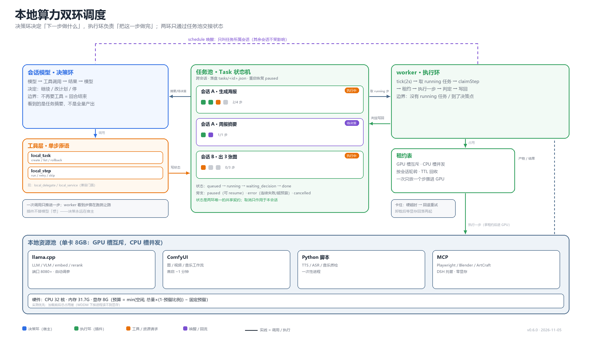
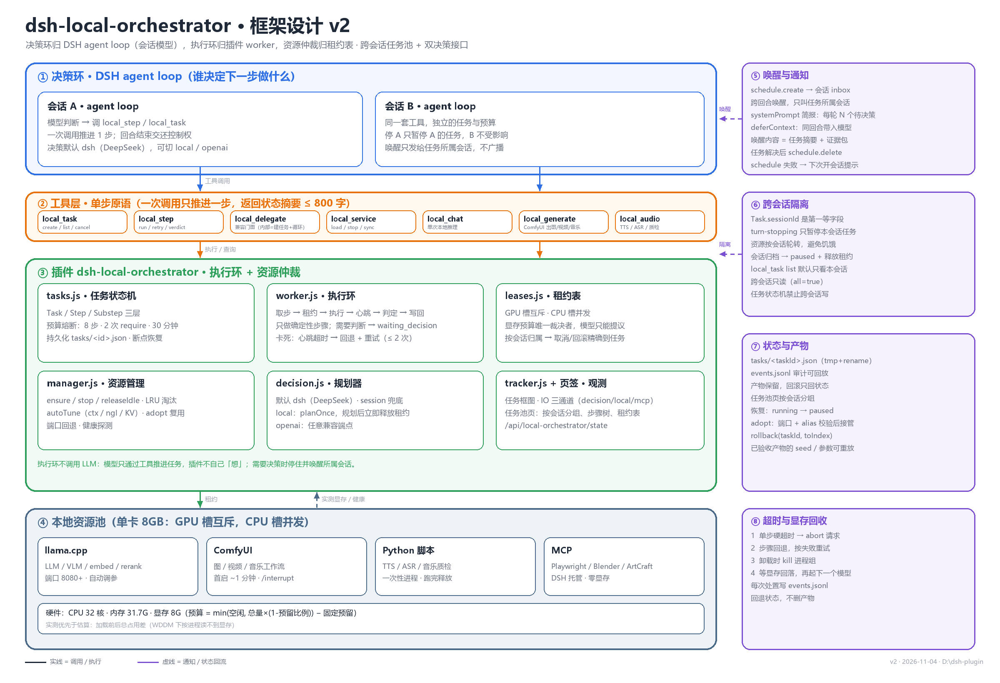
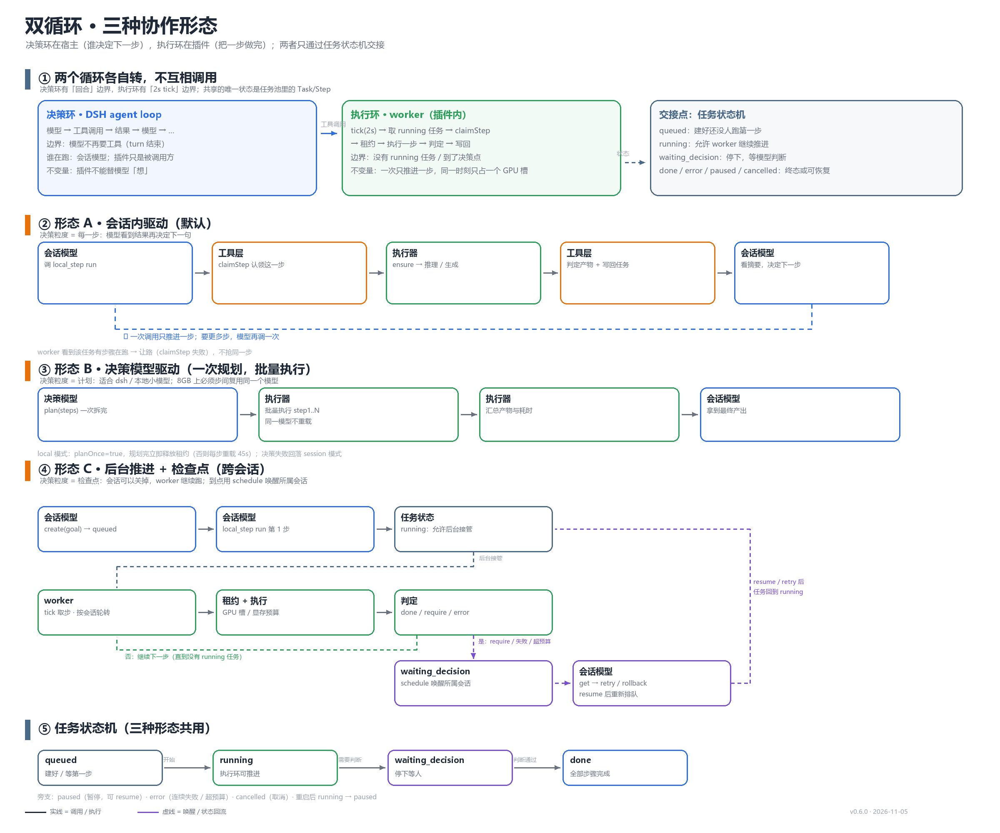

# 有限资源调度器 · 改造方案 v2

> 对象：`dsh-local-orchestrator`（当前 v0.4.0，`D:\dsh-plugin`）
> 依据：《有限资源调度器 dsh 插件框架设计》（2026-11-04）+ 本仓库现状代码 + 当前 DSH 宿主能力实查
> 结论：v1 的「任务池 / 工作队列池 / 执行步骤池 + 资源调度感知器」四件套**保留语义、换实现**——
> 决策环归 DSH agent loop，执行环归插件 worker，资源仲裁归插件租约表。



> 一张图看两个循环：决策环（左）→ 工具层 → 任务池（中）→ 执行环（右）→ 资源池（下），
> 紫色虚线是「到检查点唤醒所属会话」。由 `render/diagram_flow.py` 生成。



> 图由 `render/diagram_v2.py` 生成，改文案后重跑即可。



> 运行循环图：决策环 / 执行环各自怎么转，A/B/C 三种形态在一次运行里长什么样。
> 由 `render/diagram_loops.py` 生成。

---

## 0. 相对 v1 docx 的差异

| v1 的说法 | v2 的处理 | 原因 |
|---|---|---|
| 三池 + 感知器作为一个独立调度器 | 拆成「任务状态机（数据）」+「worker（执行）」+「租约表（资源）」 | 插件里没有常驻决策通路，自建调度器等于重写 agent loop |
| 子步骤「加入队列首，交给决策模型处理」 | 步骤标记 `waiting_decision`，用 `ctx.schedule.create` 唤醒**所属会话**；同回合内用 `deferContext` | 宿主已有持久化提醒 + 会话唤醒通路 |
| 运行时探测「交互窗口」再拆子步骤 | 计划阶段**声明式**给出 `substeps`，执行期不探测 | 交互窗口没有可靠运行时信号 |
| 「kill 卡死进程，回退为未执行」 | 四级处置：abort → interrupt/清队列 → kill 进程组 → 等显存回落；再回退状态 | ComfyUI 首启约 1 分钟，kill 是重罚 |
| 「资源超出时由决策模型决定参数」 | 预算引擎裁决，模型只能**提议** | 8GB 卡的默认参数本身就不可用（7665MB 实测） |
| 「不可用时由决策模型给一个可用文件」 | 候选**枚举**后模型只做选择 | 模型编路径必然出错 |
| 「所有任务池状态保存，统一回退」 | 状态回退 + 产物保留 + 按会话隔离回退 | 跨会话任务不能互相连坐 |

---

## 1. 目标与非目标

**目标**

1. 一次「任务」= 一串可恢复的步骤，跨工具调用、跨回合、跨会话存活；进程重启后可续跑。
2. 单卡 8GB 上，任何时刻显存占用由**租约表**唯一裁决；换模型必须走预算。
3. 决策模型可插拔：默认 DSH 自带（DeepSeek），本地模型/OpenAI 兼容端点作为可选接口。
4. 任务按会话隔离：停 A 不碰 B；并发时公平轮转，饿不死。
5. 每个步骤可观测：状态、耗时、心跳、参数、产物、可回放。

**非目标（本方案不做）**

- 不做通用 agent 框架（不实现 LLM 循环、不替代 `agentLoop`）。
- 不做多机/多卡调度（当前单卡；预留 `slotId` 字段）。
- 不接管 MCP 进程生命周期（仍由 DSH 的 MCP 客户端管理，插件只登记开销）。
- 不做模型效果评测平台（`evaluate` 步骤只做客观检查 + 可选 VLM 打分）。

---

## 2. 关键概念：两个循环，三种协作形态

「循环」有两层，必须分开说：

```
决策环（DSH agent loop，插件不能替代）
  模型 ──工具调用──▶ 插件 ──工具结果──▶ 模型 ──▶ … ──▶ 回合结束
  ↑ 谁来决定「下一步做什么」就是这一环，它需要 LLM、上下文、停止语义、审批，全是宿主的

执行环（插件 worker）
  从任务池取「已就绪、且不需要人/模型判断」的步骤 ──▶ 按租约执行 ──▶ 写回状态
  ↑ 它只认确定性的活：加载模型、跑固定提示词、轮询 ComfyUI、落盘、校验产物
```

**「循环由会话模型驱动」的准确含义**：插件不自己发起「想一步 → 做一步 → 再想」的推理循环；
它把任务切成步骤、把每一步做成工具能触发的原子操作，由会话模型决定何时推进、推进哪一步、
失败怎么办。插件只保证：同一时刻资源用对、状态不丢、卡住能收尸。

对应到实现，三种协作形态**同时存在**，由配置切换：

| 形态 | 触发者 | 适用 | 默认 |
|---|---|---|---|
| **A 会话内驱动** | 会话模型调 `local_step`，一次推进 1 步 | 交互式、需要看中间结果 | ✅ |
| **B 本地决策模型驱动** | `local_step` 内部由 decision 模型选下一步，批量执行 2~5 步 | 离线/省钱、整批任务 | 可选 |
| **C 后台推进** | worker 定时器自主执行**确定性**步骤；需判断时停住并唤醒所属会话 | 关掉页面也要跑完的长任务 | ✅（可关） |

形态 C 是「跨会话任务池」能成立的原因：会话 A 关掉后，它任务里剩余的确定性步骤继续由 worker 跑；
跑到需要判断的步骤，标记 `waiting_decision`，用 `schedule` 唤醒 A 的会话（不是广播给所有人）。

---

## 3. 总体架构

```
┌──────────────────────────── DSH Host ────────────────────────────┐
│ agentLoop(会话A)   agentLoop(会话B)         schedule 服务          │
│      │ 工具调用         │ 工具调用              ▲ 唤醒(仅所属会话)   │
│      ▼                  ▼                     │                   │
│ ┌──────────────── tools 注册（local_*）────────┴───────────────┐  │
│ │ local_task / local_step / local_delegate / local_service …   │  │
│ └───────────┬──────────────────────────────────────────────────┘  │
│             ▼                                                     │
│  ┌──────────────── dsh-local-orchestrator ───────────────────┐    │
│  │ tasks.js    Task/Step/Substep 状态机 + 持久化 + 预算熔断    │    │
│  │ worker.js   执行环：取步 → 租约 → 执行 → 心跳 → 判定 → 写回  │    │
│  │ leases.js   资源租约表（GPU 互斥 / CPU 并发 / 会话归属）     │    │
│  │ manager.js  现有 Orchestrator：ensure/stop/autoTune/adopt   │    │
│  │ decision.js 规划器（session|dsh|openai|local 四模式）        │    │
│  │ tracker.js  run/node/IO 轨迹（保留，挂到 taskId 上）         │    │
│  └────────────────────────────────────────────────────────────┘    │
└────────────────────────────────────────────────────────────────────┘
```

数据流（一次任务）：

```
建任务 → 规划(plan) → 步骤入队 → worker 取步 → 租约(GPU) → 执行 → 产物/心跳
   ▲                                                              │
   └──────── 会话模型看结果、决定继续/改计划/放弃 ◀────────────────┘
              （需要判断时：waiting_decision → 唤醒所属会话）
```

---

## 4. 数据模型

### 4.1 Task

```js
{
  id: 'task-20261104-3f2a',
  sessionId: 'session-…',          // 归属会话，取消/唤醒都按它过滤
  title: '生成 3 个分镜并出图',
  goal: '……用户原始任务……',
  status: 'queued|running|paused|waiting_decision|done|error|cancelled',
  createdAt, updatedAt, startedAt, endedAt,
  plan: { summary, steps: [Step…] },   // 冻结的计划快照（改计划=重新规划，存 planVersion）
  planVersion: 1,
  cursor: 0,                            // 下一个待执行步骤下标
  budget: { maxSteps: 8, maxRequires: 2, maxWallMs: 1800000, usedMs: 0, usedTokens: 0 },
  artifacts: [ { step: 2, path: '…', kind: 'image', ms: 42000 } ],
  decision: { model: 'dsh-deepseek', mode: 'session', lastAt: '…' },
  error: null, pauseReason: null
}
```

### 4.2 Step

```js
{
  index: 2,
  goal: '用分镜1出图',
  kind: 'image|llm|vlm|audio-tts|audio-asr|evaluate|require',
  asset: 'zimage',                 // 可空=由 pick() 决定
  dependsOn: [0, 1],
  substeps: [                      // 声明式，执行期不探测
    { index: 0, action: 'load', asset: 'comfyui' },
    { index: 1, action: 'submit', params: { prompt: '…', seed: 42 } },
    { index: 2, action: 'poll', artifact: 'output.png' }
  ],
  status: 'pending|ready|running|waiting_decision|done|error|skipped|rolled_back',
  attempts: 0,
  startedAt, endedAt, ms,
  heartbeatAt,                     // 执行器每 2s 写一次
  deadlineAt,                      // hard timeout
  verification: { mode: 'artifact|http|require', expect: {…}, ok: null },
  checkpoint: { substep: 1, payload: {…} }   // 中断后续跑用
}
```

### 4.3 Lease（资源租约）

```js
{
  id: 'lease-…',
  slot: 'gpu0' | 'cpu',
  holder: { sessionId, taskId, stepIndex },
  assetId: 'qwen36',
  vramMb: 4680,            // 实测优先，估算兜底
  ttlMs: 1200000,
  since, lastRenewAt
}
```

租约是**唯一**的占用凭据：`ensure()` 变成「先拿租约 → 再拉进程」，`stop()` 变成「释放租约 → 停进程」。
按会话取消 = 释放该会话的租约 + 回退它的步骤；租约表里能直接看到「谁占着卡」。

---

## 5. 状态机与跨会话隔离（回答第 2 问）

Task 状态迁移：

```
queued ──worker取──▶ running ──▶ done
  │                    │  ├──▶ error（熔断/超限）
  │                    │  ├──▶ waiting_decision ──唤醒──▶ running
  │                    │  └──▶ paused（用户暂停/会话归档）
  └──cancel────────────┴──▶ cancelled
paused ──resume──▶ queued      （保留 cursor/checkpoint/产物）
```

**隔离规则**

1. 每个 Task 有 `sessionId`；`local_task cancel` 默认只作用于**调用方会话**的任务（`exec.agent?.id`）。
2. 会话停止事件 `agent/turn-stopping` 只处理该 agent 名下的任务：正在跑的步骤 → abort + 回退到
   `pending`（不是删除），任务转 `paused`；**其它会话的任务完全不动**。
3. 资源冲突时按会话轮转（round-robin）而不是 FCFS：避免会话 A 一次提交 10 个任务饿死会话 B。
4. 会话被归档（`workspace/session-stop`）→ 该会话任务全部 `paused` 并释放租约，重启会话时可 resume。
5. 任务状态机**不允许**跨会话写：任何写操作校验 `task.sessionId === callerSessionId`，除 `local_task list --all`。

---

## 6. 资源仲裁：从「按需 ensure」到租约

现有 [lib/manager.js](../lib/manager.js) 的 `ensure/stop/releaseIdle` 继续用，外面包一层：

```js
async reserve({ assetId, kind, sessionId, taskId, stepIndex, exclusive = true, ttlMs }) → Lease
async renew(leaseId)
async release(leaseId, { reason })          // 停进程或保留（pinned）
async leases() → Lease[]                    // 给 status()/UI
```

关键规则（都在 `#withLock` 里执行，保持现有串行链）：

- GPU 槽互斥时：新租约必须先淘汰旧租约（`releaseIdle` / 按 priority+lastUsed）；
- 淘汰前检查「旧租约的持有者是不是同一个会话的后续步骤」——是则保留模型，省一次 45s 冷启；
- 同一任务内连续使用同一模型 → 续租而不是重拿；
- `pinned` 资产不参与淘汰，但 `pinned` + 8GB 会挤掉主模型，配置里要显式警告。

---

## 7. 单步执行语义

`local_step run`（形态 A）一次只做一件事，返回结构固定（≤ 800 字）：

```
▶ 步骤 2/5：用分镜1出图
- 资产：zimage（ComfyUI 已加载，复用）
- 耗时：42.3s  显存峰值：5.9GB（租约 gpu0）
- 产物：outputs/20261104/…png（1024×1024，1.2MB）
- 判定：artifact ✓
下一步：步骤 3「给分镜1写旁白」需要文本模型（当前未加载，预计 45s）
```

形态 B（本地决策模型）：`local_delegate` 内部一次规划 N 步，worker 连续执行到「需要判断」为止，
**一次加载、多步复用**——避免「每步 re-plan → 每步重载 45s」的显存/时延灾难。

形态 C（worker）：

```
tick(2s):
  1. 取 ready 步骤（按 task.priority、session 轮转）
  2. 若需要 GPU：reserve → 失败则等待/淘汰
  3. 执行 substeps，每 2s 心跳；软超时报告，硬超时收尸
  4. 判定：artifact/http → 写 done；require → waiting_decision + 唤醒
  5. 任务全部完成 → 释放租约 → 摘要进 systemPrompt 简报
```

---

## 8. 双决策接口（回答第 1 问）

配置默认改为 DSH 自带模型，本地模型保留为可选项：

```jsonc
"decision": {
  "mode": "dsh",              // 默认 dsh（= 会话模型/DSH 已配置 provider）
  "provider": "deepseek",
  "model": "",
  "localAsset": "",           // mode=local 时用
  "maxSteps": 8,
  "planOnce": true,           // 一个任务只规划一次，失败再 re-plan（保护 8GB 显存）
  "fallback": "session"
}
```

| 模式 | 谁做规划 | 显存影响 | 说明 |
|---|---|---|---|
| `session`（保留） | 会话模型自己看工具 | 0 | 和 `dsh` 等价，只是不额外调模型 |
| `dsh`（**新默认**） | DSH 已配置 provider 的独立调用 | 0（云端） | 规划质量最好；有 token 成本 |
| `local` | 本地已注册模型 | 占 GPU 槽 | **必须** `planOnce`，否则每步重载；规划完允许立刻释放 |
| `openai` | 任意兼容端点 | 取决于端点 | 网关/自建 |

约束写进代码而不是文档：

- `mode=local` 时强制 `planOnce=true`，且规划调用使用独立租约，规划结束按 `releaseAfterPlan=true` 释放；
- 决策模型调用失败 → 回落到 `session`（把计划请求作为工具结果返回给会话模型，由它接手）；
- 任何模式下，**参数选择**都由预算引擎裁决，规划器只能给「偏好」（如 `preferLowVram: true`）。

---

## 9. 超时 / 心跳 / 回滚

| 层 | 机制 | 默认值 |
|---|---|---|
| 工具 | `ToolDefinition.timeoutMs`（宿主支持）+ `exec.signal` | 按步骤类型 60s~900s |
| 参数 | 加载超时 `scheduler.loadTimeoutMs` | 600s（现有） |
| 步骤 | 软超时 `stallSec`（无心跳多久算卡） | 120s |
| 步骤 | 硬超时 `deadlineAt` | 加载类 900s，推理类 600s，生成类 1800s |
| 任务 | `budget.maxWallMs` | 30min |

**卡死判定**：`now - heartbeatAt > stallSec`（心跳来源：llama-server `/health` + 日志尾行时间；
ComfyUI `/queue` 进度；脚本 stdout 增长）。

**处置顺序**（每一步都可观测、可取消）：

1. `AbortController.abort()` —— 断 HTTP 轮询/流式请求；
2. ComfyUI：`POST /interrupt` + `POST /queue {"clear": true}`（不杀进程）；
3. 仍无响应：kill 进程组（`taskkill /T /F`），记 `events.jsonl`；
4. **等显存回落**：轮询 `hardware.budget()` 直到 `free >= 预期` 或 15s 超时——不回落则标记 `error: vram_not_released`；
5. 步骤回退 `pending`，`attempts+1`；`attempts >= 2` → `error`，进熔断。

**回滚语义**

- 回退**状态**与**资源**（租约、端口、临时文件）；
- 产物**保留**（重试可复用，避免重复生成）；
- 回滚不删日志；`seed/params` 必须记录，支持「同 seed 重放」；
- 只支持「回退到某步」（`rollback(taskId, toIndex)`），不支持撤销外部副作用（发消息/调外部 API 类步骤标 `irreversible: true`，回退时提示人工确认）。

---

## 10. 完成判定与 require 熔断

三种判定（v1 的三条，落到字段上）：

| 判定 | 写法 | 例子 |
|---|---|---|
| 产物 | `verification: { mode: 'artifact', expect: { path, minBytes, width, height, durationSec } }` | 出图、出视频 |
| 接口 | `verification: { mode: 'http', expect: { minContentChars: 20 } }` | chat/embedding |
| 人工/模型 | `verification: { mode: 'require', question: '…' }` | 文案质量、风格是否符合 |

熔断（防小模型自循环，v1 缺失）：

- 每任务 `maxRequires`（默认 2）、`maxSteps`（默认 8）、`maxWallMs`（默认 30min）；
- 同一步连续失败 2 次 → `error`，输出「证据包」（stderr 尾 50 行 + 产物清单 + 参数）给会话模型；
- `require` 步骤本身不再触发新规划，只允许「继续/重试/放弃」三选一。

---

## 11. 依赖图与显存峰值

v1 说「编码器/解码器与主模型绑定」，方向对，但要落到数据上：

```jsonc
{
  "id": "minimax-h3-t2v",
  "group": "minimax-h3",
  "requires": [
    { "asset": "comfyui", "role": "framework" },
    { "file": "encoder/qwen3vl-32b…safetensors", "role": "encoder" },
    { "file": "vae/minimax_h3_video_vae…safetensors", "role": "vae" }
  ],
  "peakVramMb": 6100,          // 整组实测峰值，不是逐项相加
  "phases": ["encode", "diffuse", "decode"]   // 分阶段换入换出
}
```

规则：

- 预算按 **`peakVramMb`** 算，不按文件大小和（19.5G+15G+5G 会永远判「放不下」）；
- `requires[role=framework]` 必须先 ready（`comfyui` 未加载 → 先加载，算在同一个租约里）；
- 新增资产时必须跑一次「体检」：`local_service inspect` 校验文件存在、`/object_info` 能解析、峰值可测；
- 体检失败 → 资产标 `unverified`，可选但不参与自动选择（**不允许**模型编路径）。

---

## 12. 唤醒与通知

| 场景 | 手段 | 说明 |
|---|---|---|
| 同回合内需要模型判断 | 工具结果直接返回 + `exec.deferContext(msg)` | `ToolRunContext` 提供，注入时机需按宿主版本验证 |
| 跨回合（用户还开着会话） | 工具结果 + systemPrompt 简报「你有 N 个任务待决策」 | 现有 `ctx.systemPrompt.context` 扩展 |
| 跨回合（用户已关会话） | `ctx.schedule.create(sessionId, { title, prompt, after_seconds })` | 宿主持久化提醒，投递进该会话 inbox 并唤醒；任务解决后 `delete` |
| 会话归档 | `workspace/session-stop` → 任务 `paused` | 不唤醒，恢复时再续 |

注意：

- `schedule.create` 要求 `title` 非空、有频率限制（最小间隔需实测），失败要降级为「下次打开会话时提示」；
- **不要**给别的会话发通知（跨会话只看不扰）；
- 系统提示简报必须压缩（每任务 ≤ 80 字），否则污染上下文。

---

## 13. 工具契约（给模型看的）

保留现有 7 个工具不动，新增 2 个：

### `local_task`

```
action: create | list | get | pause | resume | cancel | rollback | replan
```
- `create {goal, title?, plan?}` → 建任务并**返回计划**（不自动跑，让模型确认）
- `list {scope?: 'mine'|'all'}` → 默认只列本会话
- `cancel {taskId}` → 只允许本会话

### `local_step`

```
action: run | retry | skip | inspect | verdict
```
- `run {taskId}` → 执行**一个**步骤（形态 A），返回步骤摘要 + 下一步预告
- `verdict {taskId, step, decision: 'accept'|'retry'|'drop', note?}` → 处理 require

`local_delegate` 保留为兼容门面：内部 = `create + 循环 run`，行为与现在一致（现有测试不破）。

工具描述里明确写「一次 run 只推进一步」，避免模型误以为一次调用跑完整个任务。

---

## 14. 持久化与恢复

```
~/.dsh/local-orchestrator/
  tasks/
    index.json                 # { sessionId: [taskId…] }
    <taskId>.json              # 单任务快照（tmp + rename 原子写）
  events.jsonl                 # 审计（现有）
  logs/                        # 进程日志（现有）
```

- 写策略：状态变更**同步落盘但不阻塞**（先内存改、异步 flush，`dispose` 时等待）；
- 恢复：启动时扫 `tasks/`，`running` 的步骤一律降级为 `paused`（进程可能已死），`waiting_decision` 保留并
  重新挂 `schedule`（若已被删则重建）；
- adopt：重启后若 `llama-server` 还在监听（`#adopt` 已有），把租约恢复给对应任务，而不是杀掉重来；
- 清理：终态任务保留 `tasks.keepFinished`（默认 100）条，超出按时间淘汰，产物不动。

---

## 15. UI（「本地调度」页签）

新增 **「任务池」** 子页：

- 左侧按会话分组（每个会话一张卡：进行中 / 待决策 / 已暂停 / 已完成）；
- 右侧任务详情：步骤树（步骤 → 子步骤）带状态色、耗时、心跳、租约、产物缩略图；
- 顶部：租约表（`gpu0` 当前持有者、显存、剩余 TTL）、队列、全局预算；
- 操作：暂停/恢复/取消（仅本会话）、回滚到最后成功步、打开产物目录；
- 「输入输出」栏沿用现有三通道（decision / local / mcp），按 `taskId` 过滤。

数据来自 `/api/local-orchestrator/state`（已有），新增 `tasks`、`leases` 字段；SSE 可选，先沿用 1.5s 轮询。

---

## 16. 配置项（新增）

```jsonc
{
  "tasks": {
    "enabled": true,
    "maxSteps": 8,
    "maxRequires": 2,
    "maxWallMin": 30,
    "stallSec": 120,
    "heartbeatSec": 2,
    "keepFinished": 100,
    "background": true,          // 形态 C 开关
    "fairness": "round-robin"    // round-robin | fcfs
  },
  "worker": { "tickMs": 2000 },
  "decision": { "planOnce": true, "releaseAfterPlan": true },
  "wake": { "mode": "schedule", "minDelaySec": 5 }
}
```

---

## 17. 代码改动清单

| 文件 | 改动 | 量级 |
|---|---|---|
| `lib/tasks.js` | **新增**：Task/Step 模型、状态机、预算熔断、持久化、恢复 | ~600 行 |
| `lib/steps.js` | **新增**（v0.7.0）：单步执行器，前台 `local_step` 与后台 worker 共用 | ~260 行 |
| `lib/worker.js` | **新增**：tick 循环、取步、公平轮转、唤醒（执行细节已下沉到 steps.js） | ~230 行 |
| `lib/leases.js` | **新增**：租约表 + 与 manager 的桥接 | ~200 行 |
| `lib/budget.js` | **新增**（v0.7.0）：LLM / 工作流 / 脚本 / MCP 统一记账与快照 | ~180 行 |
| `scripts/bench.mjs` | **新增**（v0.7.0）：三条可复现指标（恢复率 / 公平性 / 单步开销） | ~200 行 |
| `lib/manager.js` | 加 `reserve/renew/release/leases`；`ensure` 改为租约的语法糖；`#stop` 支持「保留模型」 | +150 行 |
| `lib/decision.js` | `plan()` 产出 `substeps/requires/verification`；`execute()` 改为调 worker；新增 `verdict()` | +120 行 |
| `lib/tools.js` | 新增 `local_task` / `local_step`；`local_delegate` 改门面 | +350 行 |
| `lib/index.js` | `turn-stopping` 按会话取消（改语义）；注册 worker 定时器；可选 `schedule` 注入 | +60 行 |
| `lib/tracker.js` | run 挂 `taskId`；节点支持 substep 层级 | +50 行 |
| `lib/api.js` / `lib/client.js` | 任务池页 + 租约表 | +400 行 |
| `lib/catalog.js` | `group/requires/peakVramMb` 字段与同步 | +80 行 |
| `lib/config.js` | 新配置项与默认值 | +30 行 |
| `test/` | 新增 5 个测试文件（见 18） | +400 行 |

---

## 18. 分期与验收标准

> **进度（2026-11-05）**：P1/P2/P3 已全部实现，v0.7.0。
> - P1：`lib/tasks.js`、`local_task` / `local_step`、按会话隔离与取消、`tasks/` 落盘与重启恢复、预算熔断。
> - P2：`lib/worker.js` 后台执行环、`lib/leases.js` 租约表、单步硬超时收尸、`schedule` 唤醒所属会话、
>   按会话公平轮转、卸载后等显存回落（`scheduler.waitVramRelease`）。
> - P3：`peakVramMb` 整组峰值预算、`requires[role=framework]` 前置、`evaluate` 评估步骤、`/state.leases|worker`、任务池页签。
> - v0.7.0（按「资源调度运行时」定位收口）：`lib/steps.js` 单步执行器（前后台共用）、
>   `lib/budget.js` 统一预算表、暂停真正打断步骤、`scripts/bench.mjs` 三条可复现指标。
> 测试：新增 `tasks` / `worker` / `evaluate` / `budget` 测试与任务池渲染用例，全量 77 例通过。

### P1 · 任务状态机（2~3 天）— ✅ 已实现

- `tasks.js` + `local_task` + `local_step` + 按会话取消 + 持久化恢复。
- **验收**
  1. 会话 A、B 各建一个任务，停 A → A 任务 `paused`，B 继续 `running`；
  2. 重启 Harness → 任务还在，`resume` 能从断点继续；
  3. `local_delegate` 现有用例全绿（行为兼容）；
  4. 新增任务池测试（已合并为 `test/tasks.test.js`，覆盖隔离/迁移/恢复/熔断）。

### P2 · worker + 租约 + 收尸（3~4 天）— ✅ 已实现

- `worker.js` + `leases.js` + 心跳/卡死/回滚 + `schedule` 唤醒 + 预算熔断。
- **验收**
  1. 建任务后关会话，worker 把确定性步骤跑完，在 require 步停住并唤醒（`schedule` 有投递记录）；
  2. `kill` 一个 llama-server → 步骤回退并重试，**显存回落前不启动下一个模型**；
  3. 同一会话连续 10 个任务时，另一个会话的任务仍能在 N 秒内拿到 GPU（公平性）；
  4. `test/worker.test.js`、`test/rollback.test.js`、`test/wake.test.js`。

### P3 · 依赖图 + 评估 + UI（2~3 天）— ✅ 已实现

- `peakVramMb` 预算、`requires` 前置、`evaluate` 步骤（客观检查 + 可选 qwen25vl 打分）、任务池页。
- **验收**
  1. `minimax-h3-t2v` 按整组峰值预算执行，不再被判「放不下」；
  2. 出图任务自动跑 evaluate，低于阈值时产出「差在哪」的结构化结论；
  3. 任务池页能看到步骤树、租约持有者、产物缩略图；停 A 后 B 的卡片不受影响。

---

## 19. 风险与对策

| 风险 | 表现 | 对策 |
|---|---|---|
| 重启后进程漂移 | llama-server 还在跑，插件不认 | 启动扫端口 + `/props` alias 校验 → adopt；不匹配才 kill |
| 唤醒延迟/失败 | `schedule` 有频率限制或会话被删 | 降级为「下次打开会话提示」+ `waiting_decision` 持久化 |
| 显存碎片化 | 反复 kill/load 后 OOM | 同模型复用优先；租约 TTL 续租；实测优先于估算 |
| 小模型规划跑偏 | 计划荒谬、循环 | `maxSteps` + `maxRequires` + 计划确认（create 不自动跑）；默认 `dsh` 模式 |
| 工具结果过长 | 污染上下文 | 步骤摘要 ≤ 800 字；详情进 UI / 日志 |
| 跨会话写冲突 | A 改了 B 的任务 | 所有写操作校验 `sessionId` |
| 8GB 上 pinned 模型 | 挤掉主模型 | 配置校验：`pinned` 且 `slot=gpu` 时给显式警告并禁止 `gpuExclusive=false` |

---

## 20. 待实测 / 待确认

1. `ctx.schedule.create` 的最小 `after_seconds`、频率上限、被删会话时的报错码。
2. `exec.deferContext()` 注入的消息是在「工具结果之后」还是「下一个模型步骤之前」，以及是否计入 token。
3. `ToolDefinition.timeoutMs` 是整体超时还是空闲超时；超时后的结果是 `ABORTED` 还是错误文本。
4. ComfyUI 的 `/interrupt` + `/queue clear` 在「工作流已提交、模型正在加载」阶段是否真的能中断。
5. `agentTeams.createTask/waitForChange` 是否比自建任务表更合适（跨会话任务可见性、UI 复用）。
6. 是否要把「任务」也暴露成 DSH 的 `schedule` 记录（让用户能在提醒列表里看到并取消）。
